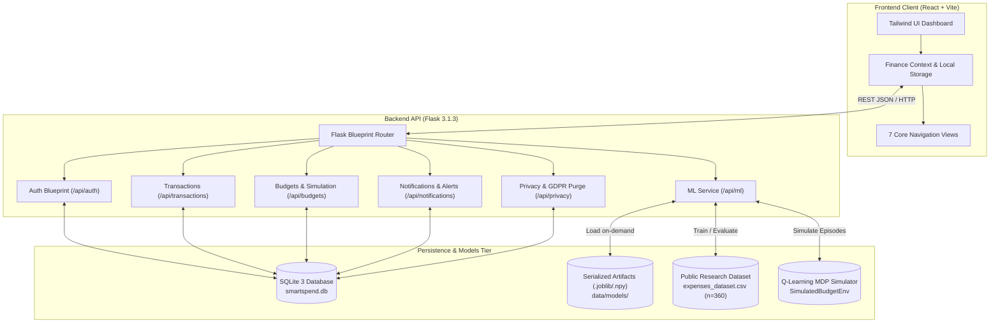
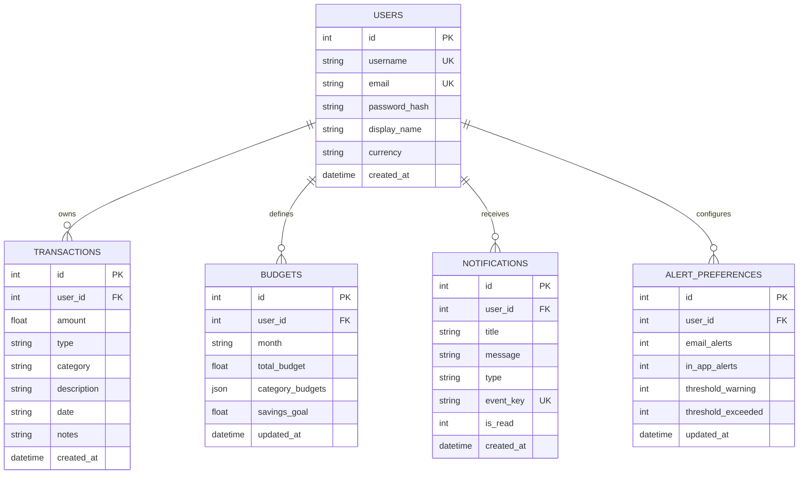
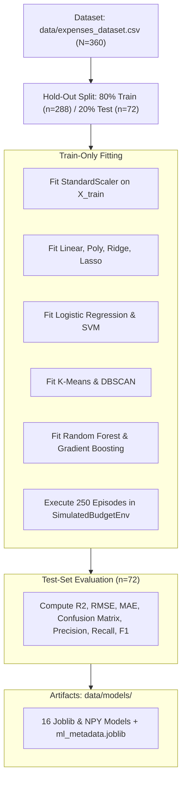

# SmartSpend AI — Technical System Architecture

## 1. Architectural Overview & Technology Stack

SmartSpend AI is built with a decoupled client-server architecture:
- **Frontend Presentation Tier:** React 19, Vite 8, TailwindCSS, Recharts, Lucide Icons.
- **Backend Application Tier:** Python 3.13, Flask 3.1.3, Werkzeug 3.1.9 (PBKDF2 password security, Blueprint routing, CORS middleware).
- **Machine Learning & Simulation Engine:** scikit-learn 1.8.0, pandas 2.3.3, numpy 2.4.1, joblib 1.5.3.
- **Persistence Tier:** Local SQLite 3 embedded relational database with strict foreign keys and transactional context management.

---

## 2. High-Level System Architecture Diagram

---

## 3. Strict Data Separation Protocol

To ensure privacy, mathematical validity, and zero data leakage, the system maintains strict physical separation between three distinct data domains:

1. **User Transaction Data (`data/smartspend.db`):**
   - Personal user finances, private banking transactions, user-defined budgets, and in-app alerts.
   - Encrypted at rest via SQLite, user-isolated by `user_id`. Never leaked into machine-learning training sets.
2. **Public Research Training Dataset (`data/expenses_dataset.csv`):**
   - 360 anonymized historical monthly household expense records.
   - Used exclusively by `backend/ml_pipeline.py` to fit scalers, regression models, classification models, and clusterers.
   - Preprocessing is fitted strictly on the $80\%$ training split ($n=288$); the $20\%$ hold-out split ($n=72$) is never seen during transformation fitting.
3. **Reinforcement Learning Simulation (`SimulatedBudgetEnv`):**
   - Fully synthetic Markov Decision Process (MDP) environment with stochastic shocks and daily action decisions.
   - Used exclusively for offline Q-table policy generation.

---

## 4. Relational Database Schema (`data/smartspend.db`)

### Schema Integrity & Safeguards:
- `PRAGMA foreign_keys = ON`: Cascades deletions and rejects orphaned foreign keys.
- `PRAGMA busy_timeout = 5000`: Prevents database locking conflicts during concurrent reads.
- `transaction_scope()` Context Manager: Guarantees atomic `COMMIT` or rollbacks on unhandled exceptions.

---

## 5. Machine Learning Pipeline & Artifact Serialization

The offline and live training pipeline (`backend/ml_pipeline.py`) executes 11 experiments:

---

## 6. Budget Progress, Alert & Security Flow

1. **Threshold Checks:** Whenever a transaction is created or modified, the backend calculates:
   $$\text{Utilization} = \frac{\sum \text{Expenses for Month}}{\text{Monthly Budget}} \times 100$$
2. **Duplicate Prevention:** In-app alerts use unique idempotency keys (`event_key = budget_warning_YYYY-MM` or `budget_exceeded_YYYY-MM`). Duplicate notifications are safely ignored by the database.
3. **Password Security:** Passwords hashed using PBKDF2-HMAC-SHA256 with 600,000 rounds and random salt.
4. **Data Privacy & GDPR Export:** `/api/privacy/export` dumps an authenticated user's records as structured JSON. `/api/privacy/purge` securely deletes all personal data across all tables.
